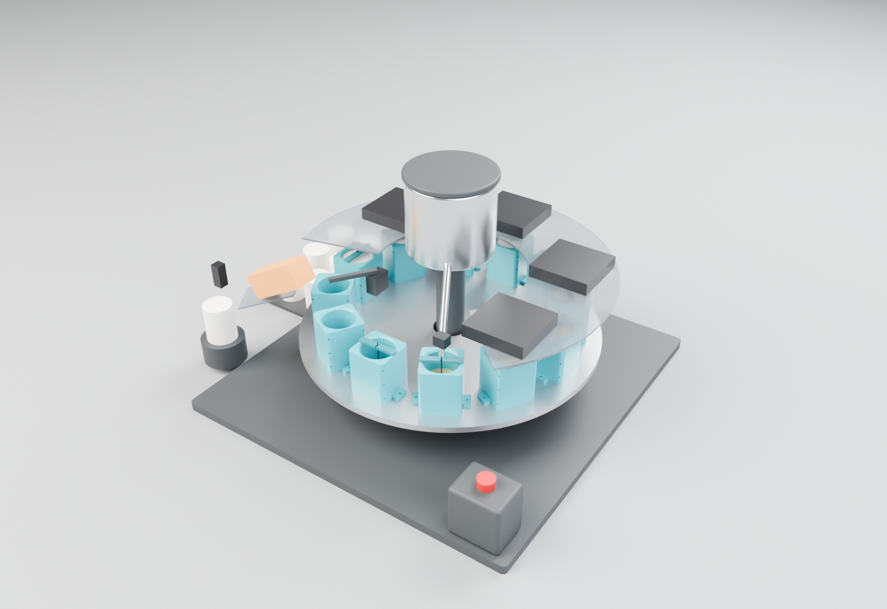

# Candle cell: automatic pour → cool → demold → finish

A rotary carousel for **soy / paraffin pillar candles** (default 60 × 80 mm) in reusable, 3D-printed **PETG** molds. It's an original design; nothing like it turned up open-source on GitHub.

## How one candle goes round (12 stations, index = 30°)

| Station | Job | How |
|---|---|---|
| 0 | **Load wick** | *Manual for v1:* drop a pre-tabbed wick onto the piston seat and clip the wick bar on (~5 s) |
| 1 | **Pour** | The central heated pot (65 °C) opens a servo valve. Load cells under the carousel stop the pour at the target weight (~205 g) |
| 2–6, 8–9 | **Cool** | A fan tunnel over the molds |
| 7 | **Top-off pour** | A second spout refills the sink hole around the wick (soy shrinks) |
| 10 | **Demold** | 1) The sweeper slides the wick bar off sideways (its slot is open on one side). 2) A lead-screw ejector pushes the floor piston up from below the disc, and the candle slides up out of the drafted bore. 3) The sweeper pushes it down the chute |
| → | **Finish** | The candle spins on a small turntable under a heat-gun pass (glossy, smooth top, seam gone), then the wick trimmer cuts it to 6 mm and it goes to the output tray |
| 11 | Spare / release spray | Optional quick release-agent mist |

## Why the mold is shaped like this

- **PETG, not PLA:** PLA softens at ~55–60 °C, below most wax pour temperatures. PETG holds to ~80 °C. Pour at **≤ 70 °C**. For beeswax (~75 °C), print the same mold in **ASA**.
- **Two halves screwed together for good, printed flat:** the layer lines then run *up and down* the bore, so the candle slides out upward. A one-piece mold printed upright would have ring-shaped layer lines that catch the wax.
- **1° draft + loose floor piston:** wax shrinks as it cools. Pushing the piston up releases the candle, the way commercial metal pillar molds work.
- **Side-open wick bar:** it can be slid off without threading the wick back out.

Print each mold set (`cad/out/mold/`): 2 halves + piston + wick bar, PETG, 0.12 mm layers inside the bore for a smooth finish, 5 walls, halves printed flat on the split face. **Make and test one mold by hand first** before building any machine.

## Throughput (estimate: confirm with a test pour)

- A candle needs ~120 min of cooling (with fans) from pour to demold, spread over 9 index steps → **one index every ~13 min**.
- That's **~4–5 candles/hour, ~35 per 8-hour shift.** Wick loading is the one manual step, every ~13 min. A wick feeder would be the next upgrade.
- Wax per candle ≈ 205 g (+ ~10% top-off). The 2 kg pot holds ~9 candles before refilling.
- **Soy pillars need a pillar-blend wax.** Container soy is too soft to stand on its own.

## Rough cost (CAD $, nothing bought)

Electronics (ESP32, 2× NEMA17 + TMC2209, servos, load cells + HX711, fans, PSU, e-stop) ~$200 · heated pot with PID + thermal fuse ~$70–90 · heat gun + relay ~$30 · lazy-susan bearing + disc + lead screw + belt ~$100 · PETG ~$75 → **≈ $450–650 CAD**. That's more than the ~$250–400 I first quoted, because the weighed pour and the finishing station add parts. A proper parts list comes next if you want it.

## Safety (read before heating anything)

- **Wax fires** can't be put out with water. Keep a class B / ABC extinguisher and a metal lid nearby.
- **The pot gets three protections:** PID thermostat at 65 °C, an independent **95 °C thermal fuse** that cuts the heater in hardware, and a hardware e-stop that cuts heater + heat gun + motors.
- **Never leave it heating unattended** until it has run many supervised cycles.
- **Heat gun:** relay-controlled, auto-off timer, aimed away from the PETG molds; ventilate.

## Files

| Path | What |
|---|---|
| `params.py` | candle size, mold walls, stations, pot, process times |
| `cad/cell.py` → `cad/out/mold/` (STL + STEP, **printable now**) and `cad/out/cell/` (concept) | |
| `render/render.py` → `render/out/` | machine overview + exploded mold |

## Next steps

1. Print one mold, pour by hand, and time the cooling. Tune `COOL_TO_DEMOLD_MIN`.
2. Detailed CAD: carousel hub and drive, pot and valves, ejector, sweeper, finishing turntable.
3. Firmware: an extension of the gantry ESP32 firmware (indexing, valve + weigh pour, ejector, heat-gun timer, temperature interlocks).
4. Parts list with Canadian sources.
