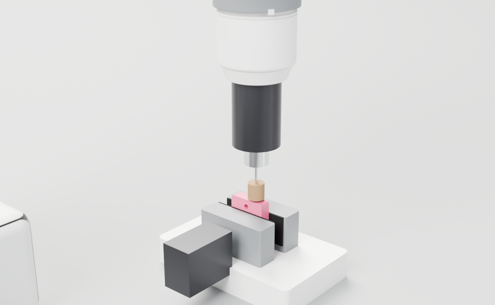
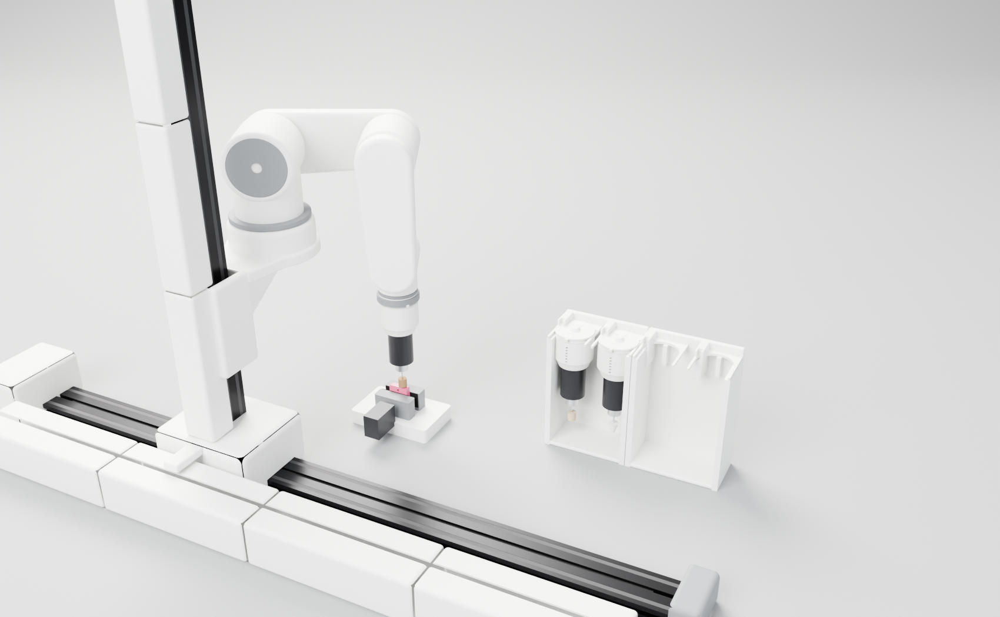

# Gantry Arm tools: handling tools the way factories do

Robots in factories don't hold human tools in a hand; **each tool becomes a quick-change attachment**. The Gantry Arm's magnetic + bayonet coupler and the passive tool rack make that work. This page covers the **small-part finishing set** (sand → fine sand → polish) and what changed to power it.

## Compliant rotary spindle (`cad/finishing_tools.py`), ×3

| | |
|---|---|
| Motor | 12 V brushless micro spindle, Ø36 × 55 mm, ER11 collet (2.35 mm jewelry / 3.175 mm rotary-tool shanks) |
| Bits | **sand**: 240-grit drum · **fine**: 600-grit drum or flap wheel · **polish**: felt bob + plastic compound. One bit per spindle, so the rack swaps whole tools and the robot never changes tiny bits |
| Compliance | The motor rides on a **spring float** (2 steel rods, ±4 mm, ~1.2 N/mm). A hall sensor reads the deflection, and deflection × spring rate = contact force. The arm holds a small **deflection set-point (≈ 2.5 mm ≈ 3 N)** instead of trying to push with its servos. That's what makes it sand evenly |
| Control | A tiny MCU in the housing answers on the **same Feetech TTL bus** as one more ID: speed in, float deflection out. No new wires through the arm |
| Power | Through **2 new high-current coupler contacts** (3.5 mm pogo pins, ≥ 5 A). The coupler now has 4 signal + 2 power contacts |
| Mass / TCP | ~300 g; the bit is 150 mm from the J5 flange. That's lighter than the 500 g payload case checked in `SIM_REPORT.md`, but with a longer lever, so the wrist pitch is the joint to watch |
| Speeds for plastics | **3,000–8,000 rpm**, light force, keep moving. PLA softens near 60 °C, and heat is the enemy |

## Servo bench vise

- Printed base and jaws with TPU pads. An STS3215 turns the screw (bus ID 21).
- The robot drops a part in with the gripper, the vise closes on it, and the spindle works the edges and faces.

## Tool rack (updated)

The spindles are 70 mm longer than the gripper. The rack modules are now taller, with their forks at **110 mm** (`params.RACK.tcp_z`), so long tools hang clear of the table. The tool-changer skill and its tests read that height from `params.RACK`, and they pass.

## What it takes to actually sand with it (software, next)

- **Finishing skill:** follow a part's edges and faces while holding the spindle's spring deflection at the set-point, a simple force loop at ~50 Hz on top of the existing motion layer. Grit sequence: sand → fine → polish, via `tool_changer.change_to()`.
- **Tool identity:** powered tools should report their type over the bus. The firmware's TOOL_ID resistor bins only cover 4 passive tools.
- **Jeweler jaw inserts** (flat, round-nose, nylon) for the parallel gripper.
- **Proving it on hardware:** spring rate, float friction, the hall sensor's calibration, and the spindle's real heat at plastic speeds.
